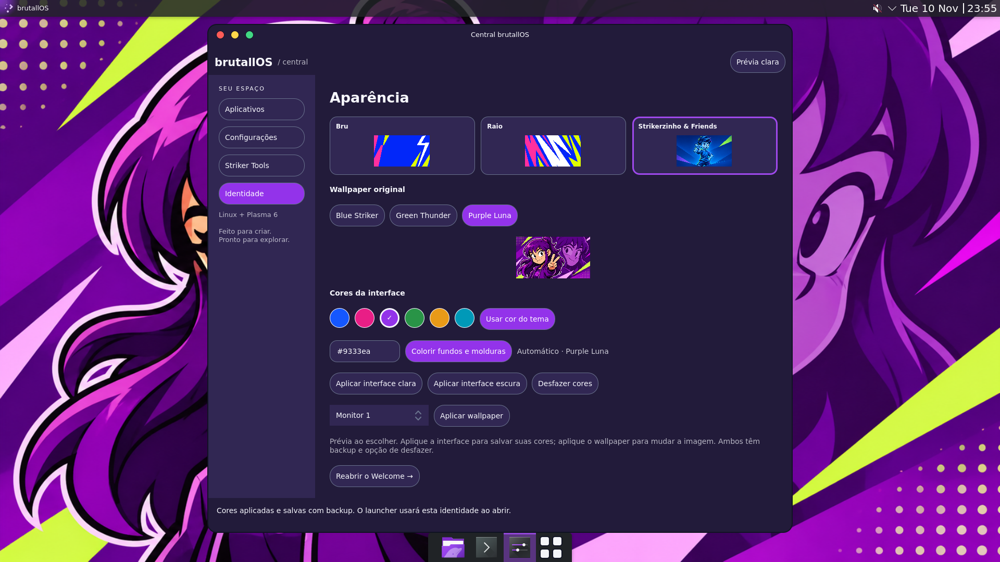

# brutallOS

<p align="center">
  <strong>Seu desktop. Sua identidade.</strong><br>
  Linux + KDE Plasma 6 · Bru · Raio · Strikerzinho &amp; Friends
</p>

<p align="center">
  <a href="CONTRIBUTING.md"><strong>Quero contribuir</strong></a> ·
  <a href="https://github.com/leonardobluestriker/brutallos/issues/new/choose">Propor uma ideia</a> ·
  <a href="docs/interface-colors.md">Ver a interface</a> ·
  <a href="docs/product-direction.md">Conhecer a proposta</a>
</p>

Uma experiência Linux temática, com personalidade, janelas arredondadas e ferramentas próprias. A proposta combina a aparência e a dock inspiradas no macOS com atalhos e controles de janelas familiares ao Windows, mantendo espaço para criar uma identidade própria.



*Captura real do desktop completo no laboratório Debian 13 / Plasma 6.3.6. Projeto em desenvolvimento: os protótipos estão disponíveis neste repositório; a ISO instalável é uma etapa futura.*

## Vamos construir isso juntos?

O brutallOS está procurando **pessoas para colaborar com código, ilustrações, design, testes e muito mais**. Não precisa saber fazer tudo, nem chegar com uma grande entrega. Uma correção pequena, um desenho, um teste bem explicado ou uma sugestão de acessibilidade já ajudam o projeto a crescer.

Queremos que o brutallOS cresça com **criatividade, experiência e decisões humanas**. A IA pode apoiar o trabalho, mas a proposta é construir uma comunidade que participe da criação, revise as soluções e dê personalidade ao sistema. Sua contribuição faz parte dessa construção.

| Sua área | Onde você pode ajudar |
| --- | --- |
| Desenvolvimento | Python, Qt/QML, Plasma, KWin, Wayland, configurações e Striker Tools |
| Ilustração e personagens | Artes do Strikerzinho, Thunder e Luna, wallpapers e materiais do projeto |
| Design e experiência | Temas, ícones, tipografia, animações, usabilidade e acessibilidade |
| Testes | Hardware real, jogos, monitores, escala, teclado e relatos de problemas |
| Documentação e tradução | Guias para iniciantes, revisão de textos e novos idiomas |
| Áudio e outras ideias | Sons do sistema e propostas que ajudem a formar a identidade do brutallOS |

> **Artistas: em breve chegam as style sheets oficiais do Strikerzinho, do Thunder e da Luna!** Elas vão servir de referência para novas ilustrações e manter a identidade dos personagens. Enquanto isso, já dá para conversar sobre ideias e conhecer as artes originais do repositório.

**[Veja como contribuir](CONTRIBUTING.md)** ou **[abra uma proposta de colaboração](https://github.com/leonardobluestriker/brutallos/issues/new/choose)** contando o que você gostaria de fazer. Quem está começando também é bem-vindo. Se conhecer alguém que curte Linux, programação ou arte, compartilhar o projeto também ajuda.

## O que já está funcionando

**Entrega atual:** destaque ajustável, cor automática por tema e fundos/molduras coloridos ou neutros, em modo claro/escuro. Purple Luna usa roxo. [Guia, validação e capturas completas](docs/interface-colors.md).

O [launcher próprio conectado à dock e os nove wallpapers originais](docs/launcher-and-wallpapers.md) continuam disponíveis com backup/desfazer. A decoração Bru mantém o sinaleiro nativo Aurorae à esquerda.

Experiência desktop sobre Linux, KDE Plasma 6, KWin e Aurorae. A distribuição própria é uma etapa posterior.

A referência técnica é [design-4.md](design-4.md), complementada pela [direção atual do produto](docs/product-direction.md). A sequência atual informada pelo projeto prevalece sobre a tarefa histórica de Fase 1 no final desse documento: **Welcome → painel superior → dock → launcher → configurações → Striker Tools**.

**Laboratório cloud executado:** Debian 13, Plasma/KWin 6.3.6 e Qt 6.8.2, com 40 testes automatizados aprovados e validação das cores nativas em X11/Wayland. Etapas anteriores validaram launcher/dock, aplicação/reversão dos nove wallpapers e duas saídas Wayland; escala 200% também foi exercitada antes. [Relatório atual](docs/interface-colors.md) e [histórico do laboratório](docs/cloud-lab-report.md). As capturas atuais usam a decoração Bru; as primeiras históricas usam Breeze.

## Onde queremos chegar

- Refinar painel, dock e launcher, incluindo a integração com Wayland.
- Completar os estilos visuais de Bru, Raio e Strikerzinho & Friends.
- Ampliar a Central de configurações e as Striker Tools com dados reais de hardware.
- Medir desempenho, uso de RAM, compatibilidade com jogos e autonomia.
- Integrar os aplicativos ArtCraft disponíveis para Linux.
- Preparar instalação, atualizações e uma futura distribuição própria, com backup e reversão.

Você pode ajudar a transformar qualquer uma dessas frentes em uma entrega concreta. O [guia de contribuição](CONTRIBUTING.md) indica os arquivos e os primeiros passos para cada área.

## Painel superior

Layout nativo para Plasma 6.3+: marca brutallOS com Kickoff funcional, menu global quando disponível, bandeja de status e data/hora. A aparência segue o tema Plasma ativo. A ferramenta prepara backup antes de criar o painel e oferece reversão apenas do painel criado; preserva os painéis existentes.

Inspeção sem sessão Plasma e sem alterações:

```sh
scripts/brutall-top-panel plan --offline
```

Os comandos de aplicação e reversão, dependências e roteiro para a VM estão em [Painel superior](docs/top-panel.md). A aplicação, reversão e persistência foram verificadas no laboratório Plasma real em contêiner. A validação em sessão completa de login e hardware/VM continua necessária; veja o relatório acima.

## Dock, launcher e Striker Tools

A [Central brutallOS e a dock](docs/center-and-dock.md) ampliam o protótipo. A central nativa reúne busca e abertura de apps instalados, acesso aos módulos de configuração disponíveis, integração com o Welcome e monitoramento real inicial de CPU/RAM/disco/rede/temperaturas/GPU quando acessíveis.

```sh
scripts/brutall-center
scripts/brutall-center --launcher
scripts/brutall-dock plan --offline
```

A dock usa o gerenciador de tarefas nativo, com agrupamento e seletor de janelas, além de backup/reversão seletiva. A central e os layouts foram exercitados no laboratório gráfico cloud; os limites estão no relatório. Perfis Gamer/Economia e benchmarks são etapas futuras.

O [registro e conexão do launcher próprio](docs/launcher-and-wallpapers.md) são opcionais e reversíveis. Sua janela lista os apps instalados, fecha com Escape e encerra após solicitar a abertura de um app. Em Wayland, ainda aparece também como tarefa enquanto aberta; esse detalhe da integração com o shell está pendente.

## brutall-welcome

Primeiro app nativo, escrito em Python/PySide6 + Qt Quick/QML. Inclui tour, seleção de identidade, preset inicial, revisão, persistência e reversão. Usa a decoração nativa da janela: na VM com o tema Aurorae ativo, os controles continuam sob responsabilidade do KWin.

As nove imagens fornecidas estão em `assets/wallpapers`, sem edição ou recompressão. Há um inventário SHA-256. Os temas são **Bru**, **Raio** e **Strikerzinho & Friends**. A suíte ArtCraft padrão é **Photocraft, Filmcraft, Wordcraft, Gridcraft e Deckcraft**; são escolhas de produto, não afirmações de que os apps estão implementados ou instalados.

### Executar sem instalar no sistema

Requer Python 3.9+ com suporte a venv e Qt 6 via PySide6. Em uma sessão gráfica Linux com as bibliotecas de plataforma Qt disponíveis:

```sh
python3 -m venv .venv
.venv/bin/python -m pip install -r apps/brutall-welcome/requirements.txt
scripts/brutall-welcome --config-dir "$PWD/.test-state/manual"
```

Esses comandos preparam apenas dependências locais ao projeto. Não usam sudo nem gerenciam pacotes do sistema. Se houver uma instalação compatível de PySide6 já disponível, é possível definir `WELCOME_PYTHON=/caminho/para/python`.

Sem `--config-dir`, o destino é `${XDG_CONFIG_HOME:-$HOME/.config}/brutallos`. Nada é gravado até clicar em **Salvar preferências**. Para um teste inteiramente isolado, mantenha `--config-dir`.

### O que esta entrega faz

- Apresenta o projeto e o tour, escolhe tema/variante e um dos quatro presets.
- Mostra os PNGs originais completos, preservando a proporção.
- Oferece aparência clara/escura/do sistema, alto contraste e foco por teclado.
- Salva somente `welcome.json`, com versão de esquema e indicador de onboarding concluído.
- Faz backup antes de cada gravação, escreve atomicamente e permite desfazer a última gravação.

O Welcome salva preferências; a **Central** oferece os comandos explícitos de aplicação de wallpaper e aparência Bru. O Welcome não instala ArtCraft nem aplica painéis ou desktops virtuais. Não há autostart instalado. A seleção de espaço continua sendo uma preferência, não um desktop virtual já criado.

### Reversão

No app: **Desfazer última gravação**. Pela linha de comando, use o mesmo diretório usado ao salvar:

```sh
scripts/brutall-welcome --config-dir "$PWD/.test-state/manual" --restore
```

O backup guarda os bytes anteriores exatos. Na primeira gravação, desfazer remove `welcome.json`. Se outro processo tiver alterado o arquivo depois do backup, a reversão é recusada para preservar essa alteração. A reversão tem um nível; uma nova gravação substitui o backup anterior. O arquivo de lock e o diretório podem permanecer vazios de preferências.

### Verificação

```sh
.venv/bin/python -m unittest discover -s tests -v
.venv/bin/pyside6-qmllint apps/brutall-welcome/qml/Main.qml
```

Consulte [a validação e os testes manuais](docs/validation.md), [as decisões de arquitetura](docs/architecture.md) e [o inventário das imagens](assets/wallpapers/README.md).

O código da decoração previamente validada pelo projeto não veio no anexo nem no repositório inicial. A [decoração Bru deste checkout](docs/bru-appearance.md) é uma implementação nova, com testes próprios no laboratório. Raio e Strikerzinho & Friends já têm seus wallpapers selecionáveis; seus estilos globais completos continuam pendentes.
