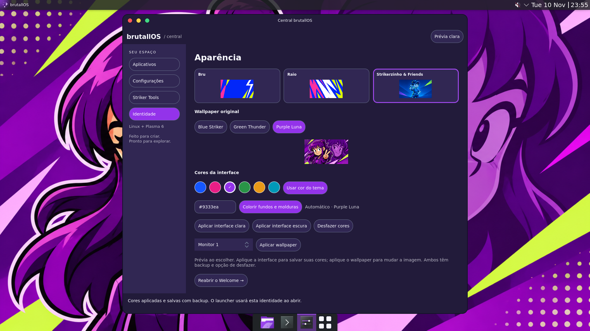
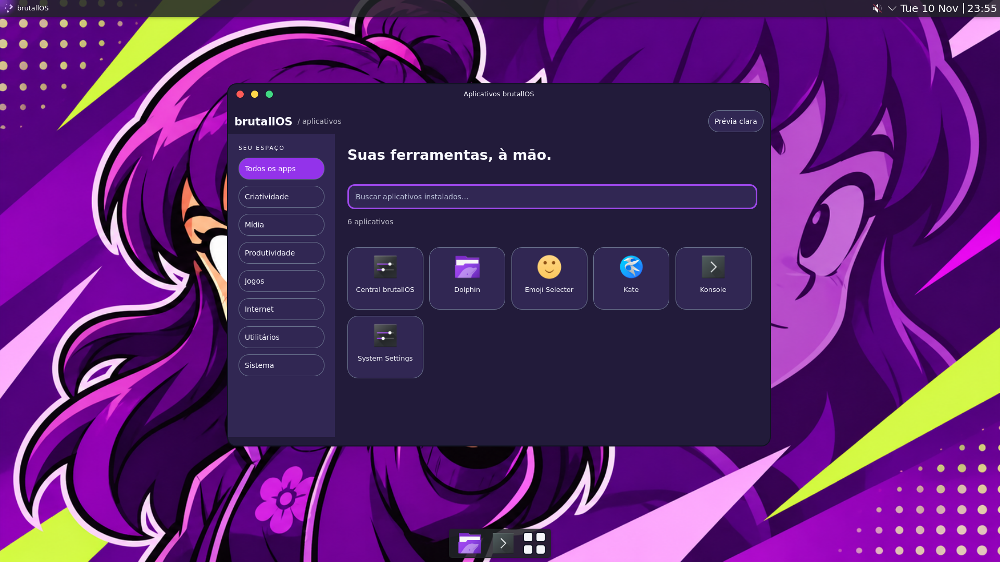
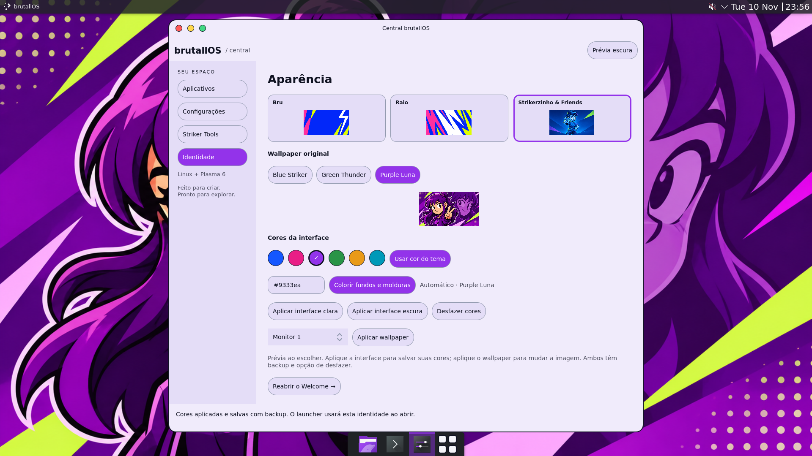

# Cores ajustáveis da interface

A Central, o launcher e o Welcome usam a identidade do tema. O verde neon deixou de ser uma constante da interface. A cor de destaque pode acompanhar o tema ou ser escolhida pelo usuário, e os fundos e molduras podem receber um tom da mesma cor, tanto no modo claro quanto no escuro.

| Identidade | Destaque automático |
| --- | --- |
| Bru | Azul `#1557ff` |
| Raio | Rosa `#e91e86` |
| Blue Striker | Azul `#1557ff` |
| Green Thunder | Verde `#299447` |
| Purple Luna | Roxo `#9333ea` |

São cores iniciais ajustáveis. Os nove PNGs originais permanecem intactos.

## Usar na Central

Em **Identidade**, selecione o tema e a variante. A prévia muda imediatamente. **Usar cor do tema** mantém o destaque automático ao trocar de variante. Escolher uma das amostras ou digitar uma cor `#RGB`/`#RRGGBB` e pressionar Enter ativa uma cor personalizada; essa escolha permanece ao trocar de tema, até voltar ao automático.

**Colorir fundos e molduras** alterna entre superfícies suavemente coloridas e neutras. **Aplicar interface clara/escura** salva a identidade e aplica o esquema de cores no Plasma, junto com a decoração Bru. **Aplicar wallpaper** continua sendo uma ação independente. O botão do cabeçalho alterna somente a prévia clara/escura.

O launcher lê a identidade salva ao abrir. O Welcome acompanha as cores da identidade exibida e usa a cor personalizada salva quando o tema/variante coincide, sem alterar suas preferências de onboarding. Texto sobre seleções escolhe preto ou branco por contraste; foco e links são ajustados para continuar legíveis com cores muito claras ou escuras. Os três controles da janela mantêm vermelho, amarelo e verde.

## Persistência e backup

Preferências: `${XDG_CONFIG_HOME:-$HOME/.config}/brutallos/interface.json`. Esquema gerado: `${XDG_DATA_HOME:-$HOME/.local/share}/color-schemes/BrutallIdentity.colors`. A implementação usa as ferramentas nativas do KDE; apps que adotam o esquema de cores recebem a nova paleta. Apps com aparência própria podem usar suas próprias cores.

Antes de aplicar, `brutall-appearance` salva os arquivos anteriores, incluindo essas duas novas entradas, os arquivos da decoração, as paletas Bru e `kdeglobals`, `kwinrc` e `auroraerc`. **Desfazer cores** restaura a última aplicação daquela instância. Backups ficam em `${XDG_STATE_HOME:-$HOME/.local/state}/brutallos/appearance/UUID.json` para reversão após fechar a Central. A restauração verifica todos os hashes antes de gravar e recusa conflitos. Os backups da versão anterior continuam aceitos.

```sh
scripts/brutall-appearance plan --mode dark --theme friends --variant purple --accent auto --tinted yes
scripts/brutall-appearance apply --mode dark --theme friends --variant purple --accent auto --tinted yes
scripts/brutall-appearance apply --mode light --theme raio --variant original --accent '#0099bb' --tinted no
scripts/brutall-appearance rollback --backup /caminho/BACKUP.json
```

A reversão recupera os bytes anteriores dos arquivos; outros apps podem precisar ser reabertos para recarregar completamente a paleta anterior. Sem argumentos de tema/cor, a ferramenta usa a identidade salva (ou a preferência inicial do Welcome).

## Validação

Laboratório isolado Debian 13, Plasma/KWin 6.3.6 e Qt/PySide6 6.8.2/6.8.2.1:

- **40 testes automatizados aprovados**, incluindo cores inválidas, persistência, tintas, geração de paleta e contraste de texto/foco em cores claras e escuras. A integridade dos nove PNGs continua verificada por SHA-256.
- Central QML real: prévia roxa da Luna, fundo neutro/colorido, edição HEX, aplicação no KDE, reabertura do launcher, troca de cor no mesmo esquema, modos claro/escuro e reversão com comparação dos bytes anteriores.
- Clientes Qt novos em X11 e Wayland: destaque e fundo nativos conferidos em roxo automático e ciano personalizado, com reversão dos arquivos.
- Decoração real: maximizar/restaurar, minimizar, fechar, arrastar pelo título e redimensionar passaram novamente.
- `qmllint` das duas interfaces passou. O laboratório não altera pacotes ou configurações do desktop do host.

Reprodução: `lab/plasma/test-accent-ui.py` na sessão X11 e `lab/plasma/test-identity-native.py` em X11 ou Wayland. As limitações de boot, hardware, integração Wayland do launcher e temas globais completos permanecem descritas no [relatório anterior](launcher-and-wallpapers.md).

## Capturas reais do desktop inteiro






