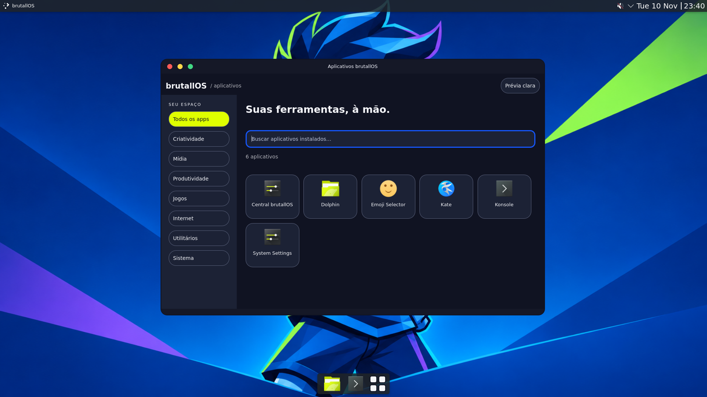
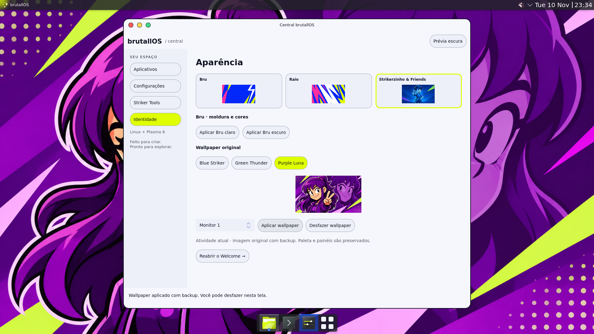
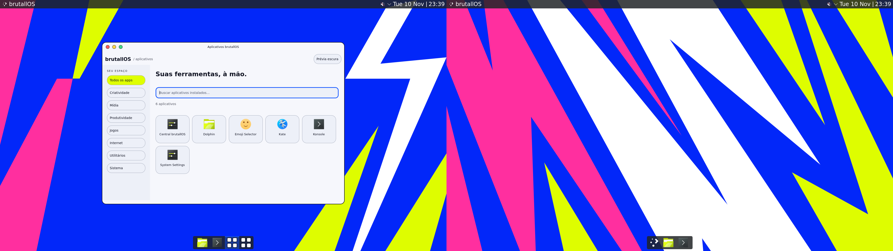

# Launcher próprio e wallpapers originais

**Etapa posterior:** [cores ajustáveis da interface](interface-colors.md), com destaque automático por tema, HEX personalizado e fundos/molduras coloridos. As capturas e a contagem de testes abaixo registram a etapa anterior.

Entrega validada em 10/11/2026 no laboratório Debian 13, Plasma/KWin 6.3.6, Qt 6.8.2 e PySide6 6.8.2.1.

O botão de quatro quadrados da dock abre o launcher brutallOS, com busca, categorias e ícones dos aplicativos realmente instalados. A busca recebe foco ao abrir; Enter solicita a abertura do primeiro resultado, Escape fecha. Uma segunda solicitação ativa a janela existente na mesma sessão gráfica. Ao fechar ou abrir um app, o processo do launcher termina.

A Central, em **Identidade**, permite escolher os nove PNGs originais de Bru, Raio e Strikerzinho & Friends, visualizar a imagem completa e aplicá-la a um monitor ou a todos os monitores da atividade atual. Os arquivos fornecidos foram preservados sem recompressão. A seleção de wallpaper é independente dos botões **Aplicar Bru claro/escuro**, que aplicam a paleta e a decoração Aurorae com sinaleiro à esquerda.

## Executar e conectar à dock

Requer a instalação local de PySide6 descrita no README ou `WELCOME_PYTHON` apontando para um Python compatível. Plasma 6, `qdbus6` (ou `/usr/lib/qt6/bin/qdbus`) e `gio` devem estar disponíveis na sessão gráfica.

```sh
scripts/brutall-center --launcher
scripts/brutall-launcher plan
scripts/brutall-launcher install
scripts/brutall-launcher connect --screen 0
```

`install` registra somente duas entradas de aplicativo e um SVG no diretório de dados do usuário. Não instala pacotes nem usa sudo. Os caminhos apontam para este checkout, que precisa permanecer no lugar. `connect` exige a dock criada por `brutall-dock` na tela escolhida; substitui somente seu launcher por um widget nativo de ícone. Preserva o gerenciador de tarefas, seus favoritos e o atalho configurado no widget anterior. Não configura um novo atalho Meta global.

Cada operação imprime o caminho de seu backup em `${XDG_STATE_HOME:-$HOME/.local/state}/brutallos/launcher`. A reversão deve seguir a ordem inversa, primeiro a conexão e depois o registro dos aplicativos:

```sh
scripts/brutall-launcher rollback --backup /caminho/CONEXAO.json
scripts/brutall-launcher rollback --backup /caminho/REGISTRO.json
```

O backup da conexão contém a árvore de configuração do launcher anterior e seu atalho; a restauração recria o widget com um novo ID. O backup do registro preserva os bytes e permissões dos arquivos anteriores e remove os arquivos que não existiam. A reversão recusa alterações posteriores que conflitem com o estado aplicado.

## Wallpapers e reversão

A interface oferece **Aplicar wallpaper** e **Desfazer wallpaper**. O botão desfaz a última aplicação feita naquela instância da Central. Os backups permanecem em disco para restauração após fechar o app:

```sh
scripts/brutall-wallpaper status
scripts/brutall-wallpaper plan --image BLUESTRIKER.png --screen 0
scripts/brutall-wallpaper apply --image PURPLELUNA.png --all-screens
scripts/brutall-wallpaper rollback --backup /caminho/BACKUP.json
```

Os números de tela da linha de comando começam em zero; a interface mostra “Monitor 1”, “Monitor 2” etc. A ferramenta aceita apenas as nove imagens do catálogo. O backup em `${XDG_STATE_HOME:-$HOME/.local/state}/brutallos/wallpaper` identifica cada desktop e guarda o plugin e a imagem anteriores. Todos os alvos são conferidos antes de iniciar a aplicação ou reversão. Um wallpaper alterado depois ou um desktop removido impede a reversão, preservando essa mudança.

A reversão do wallpaper é seletiva: restaura o plugin anterior e o valor de `Image`, sem sobrescrever outros ajustes da sessão. Se a chave `Image` não existia, pode permanecer com valor vazio. Uma cópia bruta de `plasma-org.kde.plasma.desktop-appletsrc` acompanha os backups de wallpaper e de conexão para recuperação manual com o shell parado; não é aplicada automaticamente sobre a sessão ativa.

## Validação executada

- **36 testes automatizados aprovados** no Python/Qt do Debian alvo, incluindo integridade das imagens, restauração, proteção contra conflitos e instância única.
- Sessão Plasma X11 real: nove wallpapers aplicados e desfeitos; conexão e reversão do launcher; ID do gerenciador de tarefas e favoritos preservados; clique no botão real da dock; segunda abertura sem outra janela; Escape; busca de Dolphin seguida de Enter, abertura do aplicativo e encerramento do processo do launcher.
- Central QML real: seleção e carregamento das nove prévias; aplicação de Purple Luna e reversão pela interface.
- Wayland com duas saídas: aplicação nas duas telas e reversão; aplicação somente na segunda tela mantendo a primeira intacta, seguida de reversão. Launcher abre com decoração Aurorae e mantém instância única.
- Capturas do framebuffer completo: X11 1920×1080 e Wayland 3840×1080, com as duas saídas lado a lado. Sem montagem ou recorte de janela.

Os scripts reproduzíveis estão em `lab/plasma/test-launcher-wallpaper.py`, `test-wallpaper-ui.py` e `test-wallpaper-multiscreen.py`. O laboratório é um contêiner com compositor real e renderização virtual; os resultados não validam boot, GPU física, autonomia ou consumo de RAM de uma distribuição instalada.

## Pendências conhecidas

- No Wayland, o launcher Qt também aparece como tarefa enquanto está aberto, ao lado do botão fixo de abertura. No X11, a janela utilitária fica fora da lista de tarefas. A integração de janela com o shell Wayland ainda precisa resolver esse detalhe.
- O launcher ainda usa uma janela nativa móvel, sem fechamento automático ao clicar fora, favoritos próprios ou recentes. A ativação respeita a política de foco do compositor.
- Raio e Strikerzinho & Friends têm seus wallpapers originais selecionáveis; suas paletas, ícones e estilos globais completos ainda estão pendentes. Bru claro/escuro dispõe da paleta e da moldura Aurorae. Apps com decoração própria podem não usar essa moldura.
- Escala 200% e resolução menor foram exercitadas em etapas anteriores; estes novos controles ainda precisam repetir essa matriz, além de login completo, hotplug de monitor e teclado no hardware final.
- Perfis Gamer/Economia, benchmarks, instalação da suíte ArtCraft e geração de ISO continuam como etapas futuras.

## Capturas de tela completa






